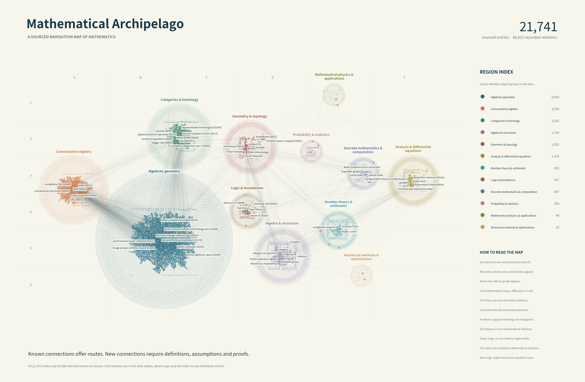

# Mafh-Island · MathCups 数学群岛

**[中文完整说明](README.zh-CN.md) · [Full documentation in English](README.en.md)**

21,741 座有出处的数学知识岛屿，46,812 条分型关系，12 个海域，21 条附文献审读记录的跨领域航线。

A two-dimensional atlas of **21,741 sourced mathematical knowledge entries**, **46,812 typed relations**, **12 domains**, and **21 cross-field bridges** with literature-reading records.

岛屿包括概念、定义、方法、问题与命题，粒度不同。数量不代表独立理论的数量；来源引用也不等于证明认证。641 对导航候选中发布了前 50 对，尚未判定数学联系或新颖性。

Islands include concepts, definitions, methods, problems, and statements at different levels of detail. They are not 21,741 independent theories or individually certified proofs. The top 50 of 641 navigation candidates are provided for investigation; mathematical validity and novelty remain unestablished.

| 内容 / Material | 中文 | English |
| --- | --- | --- |
| 使用与重建 / Guide and reproduction | [中文说明](README.zh-CN.md) | [English guide](README.en.md) |
| 总图 / Overview | [PDF](maps/mathematical-archipelago-overview.pdf) · [SVG](maps/mathematical-archipelago-overview.svg) · [PNG](maps/mathematical-archipelago-overview.png) | [PDF](maps/en/mathematical-archipelago-overview.pdf) · [SVG](maps/en/mathematical-archipelago-overview.svg) · [PNG](maps/en/mathematical-archipelago-overview.png) |
| 12 领域图册 / Twelve-domain atlas | [PDF](maps/mathematical-archipelago-domain-atlas.pdf) | [PDF](maps/en/mathematical-archipelago-domain-atlas.pdf) |
| 文献航线图 / Literature bridges | [PDF](maps/mathematical-archipelago-bridges.pdf) · [SVG](maps/mathematical-archipelago-bridges.svg) | [PDF](maps/en/mathematical-archipelago-bridges.pdf) · [SVG](maps/en/mathematical-archipelago-bridges.svg) |
| 21 条桥梁的条件与机制 / Conditions and mechanisms | [桥梁目录](reports/math-bridges.md) | [Bridge catalogue](reports/math-bridges.en.md) |
| 两层工具类型接口 / Two-level tool-type interface | [语义规范](spec/atlas-schema.md) | [Schema](spec/atlas-schema.en.md) |
| 构建记录 / Build report | [中文报告](reports/构建报告.txt) | [English report](reports/build-report.en.md) |



## 数据与导航 / Data and navigation

- [完整节点与元数据 / Nodes and metadata](data/nodes.jsonl)
- [完整关系 / Typed edges](data/edges.csv)
- [中文检索索引 / Navigation index](maps/navigation-index.csv)
- [候选联系 / Unreviewed candidates](data/research-candidates.json)
- [结构、来源与导航核验 / Structural, provenance, and navigation checks](reports/release-verification.json)
- [独立源文审查 / Independent source audit](reports/atlas-independent-audit.md)

```bash
git clone https://github.com/Lightmaze/Mafh-Island.git
cd Mafh-Island
python scripts/navigate.py search "sieve" --limit 30
python scripts/navigate.py show pm:SieveOfEratosthenes
python scripts/navigate.py route pm:ModularForm wikipedia:Sphere_packing --directed
```

导航只需 Python 标准库。中英文地图共用节点 ID、坐标与关系；来源原文和原始数学名称保持原貌。完整使用、安装和复现步骤见两种语言的说明。

Navigation uses only the Python standard library. Both map editions share node IDs, coordinates, and relations. Source texts and original mathematical names are preserved in their original languages. See either full guide for installation and reproduction.

## 范围与许可 / Scope and licensing

本版来源为 PlanetMath、Stacks Project 与 Wikipedia 补充条目；Stacks 占约 68%，覆盖明显偏重代数几何与同调。二维距离不是数学度量。16 个节点保留明确源文质量记录。两层渐近类型字段保留开放状态，未冒充完成旧 MathCups 注册表的形式类型化。

Sources are PlanetMath, the Stacks Project, and selected Wikipedia entries. Stacks accounts for about 68% of nodes, so coverage is weighted toward algebraic geometry and homological methods. Two-dimensional distance is not a mathematical metric. Sixteen nodes carry explicit source-quality findings. The two gradual-type fields remain open; this is not completed formal typing against the unavailable earlier MathCups registry.

原创脚本采用 MIT；原创编辑文档与制图设计采用 CC BY-SA 4.0。第三方文本、派生条目及引用分别保留其原许可，详见 [许可范围 / License scope](LICENSE.md) 和 [来源归属 / Third-party notices](THIRD_PARTY_NOTICES.md)。

Original scripts are MIT licensed; original editorial documentation and cartographic design are CC BY-SA 4.0. Third-party texts, source-derived records, and quotations retain their respective licenses. See the linked scope and attribution notices.

完整离线发布包见 [Releases](https://github.com/Lightmaze/Mafh-Island/releases)，校验文件清单见 [release manifest](reports/release-manifest.json)。

Complete offline archives are available under Releases, with per-file checksums in the release manifest.
